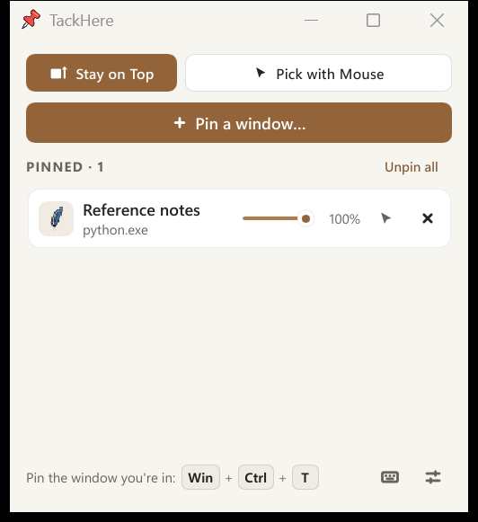

# TackHere

English · [简体中文](README.zh-CN.md)

**Click to keep a window on top.**

TackHere adds a pushpin to a Windows window so it stays visible while you work. Click the pin on the window to take it off.

[**Download TackHere.exe**](https://github.com/jwlrxy/tackhere/releases/latest/download/TackHere.exe) · [Release notes](https://github.com/jwlrxy/tackhere/releases)

For Windows x64. Run the downloaded EXE directly. TackHere lives in the system tray.



## How to use it

1. Left-click the tray icon or select **Pick with Mouse** in the main window to enter pin mode.
2. Click the window you want to keep on top. A pin appears along its top edge.
3. Click that pin to unpin the window. In pin mode, clicking an already pinned window also unpins it.

Press `Esc` or right-click to leave pin mode. You can also press `Win + Ctrl + T` to toggle the current window or choose a window from **Pin a window…**. **Stay on Top** keeps TackHere's main window above the windows it manages.

## Interaction design case study

TackHere reworks the window-pinning interaction in PinIt.

- **Put the action on the target window.** Clicking the tray icon turns the mouse pointer into a pin. The insertion and removal animations follow the angle of the pin and appear where the action takes place.
- **Put the status and the undo action together.** The pin shows that the window is on top and doubles as the unpin control. Testing led to a larger hit area around the pin so it is easier to click. Farther out, clicks still reach the title bar.
- **Redraw the marker as a vector.** The pin's perspective draws on DeskPins. Its transparent SVG is rendered at the scale of the target window's display.
- **Test the stacking order.** Regression tests reproduced a brief overlap in which a newly pinned window covered the main panel. TackHere now places the new window underneath its own panel when **Stay on Top** is enabled. Window selection, unpinning, restoring a pin, and switching between windows were also checked on an isolated Windows desktop.

## Source and credits

TackHere is based on [PinIt v3.0.0](https://github.com/Razee4315/Pin-It/releases/tag/v3.0.0) by Saqlain Abbas and retains the [Apache 2.0 license](LICENSE). The interaction redesign was published by [jwlrxy](https://github.com/jwlrxy). The pin's perspective references [DeskPins](https://github.com/PhilLab/deskpins) by Elias Fotinis. The desktop interface uses [Slint](https://slint.dev), with attribution in the About dialog. See the [third-party notices](THIRD_PARTY_NOTICES.md).

The release is built from the [Rust and Slint implementation](rust/README.md) using the MSVC toolchain and a Windows SDK.

```powershell
cargo test --manifest-path rust/Cargo.toml --locked
cargo build --manifest-path rust/Cargo.toml --release --locked
```
