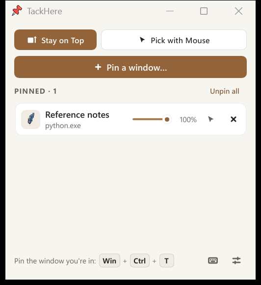

# TackHere

[English](README.md) · 简体中文

**Click to keep a window on top.**
用图钉固定 Windows 窗口。点一下置顶，点窗口上的图钉拔掉。

[**直接下载 TackHere.exe**](https://github.com/jwlrxy/tackhere/releases/latest/download/TackHere.exe) · [版本说明](https://github.com/jwlrxy/tackhere/releases)

面向 64 位 Windows。下载后打开 `TackHere.exe` 即可使用。程序驻留在系统托盘。



## 怎么用

1. 左键单击托盘图标，或在主界面点击 **Pick with Mouse**，进入取钉模式。
2. 点击目标窗口。窗口顶部会出现一枚图钉，表示它已置顶。
3. 点击窗口顶部的图钉即可拔钉。取钉模式下点击已经置顶的窗口，也会取消置顶。

`Esc` 或右键取消取钉。也可以在当前窗口按 `Win + Ctrl + T` 切换置顶，或从 **Pin a window…** 列表选择窗口。**Stay on Top** 用于把 TackHere 主窗口保持在它管理的置顶窗口上方。

## 交互设计案例

这是一项基于 PinIt 的窗口置顶交互改版。

- **让操作发生在目标窗口上。** 从托盘拿起图钉后，鼠标直接选择要固定的位置。钉下和拔出的动效顺着钉杆方向，反馈出现在操作发生的位置。
- **让状态和撤销入口在一起。** 置顶状态由窗口上的图钉表示，点图钉就能撤销。实测后扩大了图钉周边的可点击范围，靠外的透明区域仍可操作原窗口。
- **用矢量重画固定图钉。** 图钉以 DeskPins 的斜上方透视为参考，使用透明底 SVG，按窗口所在显示器的 DPI 渲染。
- **验证叠放顺序。** 对比测试复现了旧实现中目标窗口短暂盖住主界面的情况。改版将新钉住的窗口直接放到 TackHere 下方，并在隔离桌面验证了选窗、拔钉、恢复置顶和窗口切换。

## 源码与致谢

TackHere 基于 Saqlain Abbas 的 [PinIt v3.0.0](https://github.com/Razee4315/Pin-It/releases/tag/v3.0.0)，保留 [Apache 2.0 许可证](LICENSE)。交互改版由 [jwlrxy](https://github.com/jwlrxy) 发布。图钉透视参考 Elias Fotinis 的 [DeskPins](https://github.com/PhilLab/deskpins)。桌面界面使用 [Slint](https://slint.dev)，应用的「关于」页面保留 Slint 署名。相关声明见 [第三方致谢](THIRD_PARTY_NOTICES.md)。

当前发布版从 [Rust / Slint 实现](rust/README.md) 编译，需要 Windows MSVC 工具链及 Windows SDK。

```powershell
cargo test --manifest-path rust/Cargo.toml --locked
cargo build --manifest-path rust/Cargo.toml --release --locked
```
